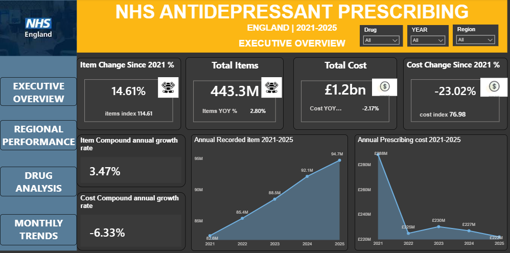
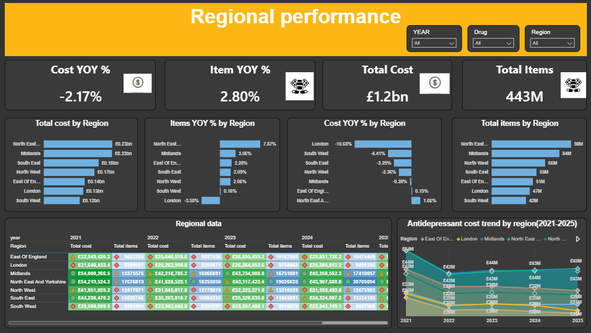
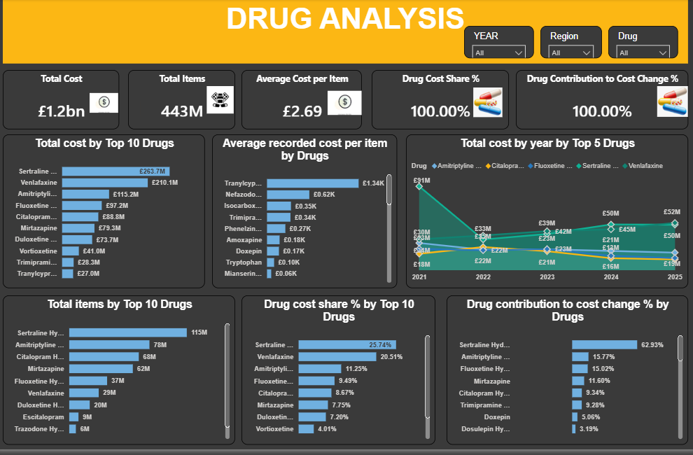
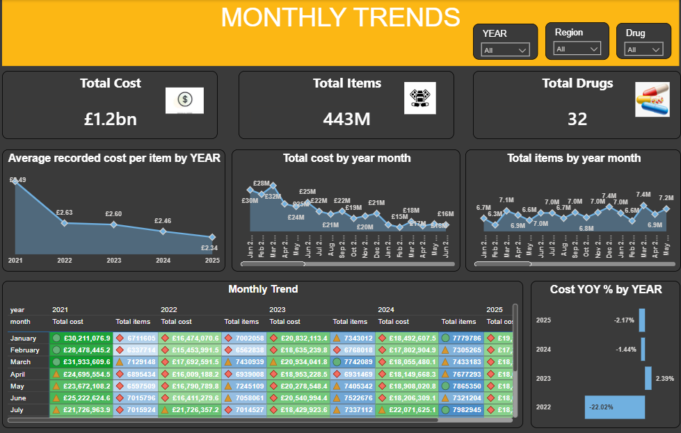

# NHS Antidepressant Prescribing in England: A Five-Year Analysis (2021–2025)


> An interactive Power BI dashboard that analyses 443 million antidepressant items and £1.2 billion of NHS spend across England, revealing how volume, cost, drug mix and regional variation have changed over five years.



---

## Table of Contents

1. [Executive Summary](#executive-summary)
2. [Project at a Glance](#project-at-a-glance)
3. [Background](#background)
4. [Data Source](#data-source)
5. [Research Objectives and Answers](#research-objectives-and-answers)
6. [Policy Relevance](#policy-relevance)
7. [Tools and Metrics](#tools-and-metrics)
8. [Dashboard Walkthrough](#dashboard-walkthrough)
9. [Key Insights](#key-insights)
10. [Recommendations](#recommendations)
11. [Limitations](#limitations)
12. [Next Steps](#next-steps)
13. [Repository Structure](#repository-structure)
14. [How to Use](#how-to-use)
15. [Author](#author)

---

## Executive Summary

Between 2021 and 2025, the NHS in England dispensed **443 million antidepressant items at a total cost of £1.2 billion**. Two trends move in opposite directions:

- **Demand is rising.** Annual items grew from 82.6M to 94.7M (**+14.6%**, a compound annual growth rate of **3.47%**).
- **Spend is falling.** Annual cost dropped from £288M to £222M (**-23.0%**, a compound annual decline of **6.33%**).

The result is that the average cost of each item fell by roughly one third, from **£3.49 to £2.34**. The cost reduction is highly concentrated: **sertraline alone accounts for 62.9% of the change in total cost**, and just **seven drugs account for about 91% of all spend**. Regionally, **North East and Yorkshire** is the highest-volume and fastest-growing region, while **London** is the only region where volume fell.

The headline message for decision-makers: **falling spend should not be read as falling demand.** More people are receiving antidepressants each year, and the savings come from lower unit costs concentrated in a very small number of drugs.

---

## Project at a Glance

| Metric | Value |
|---|---|
| Total items dispensed (2021–2025) | **443.3M** |
| Total cost (2021–2025) | **£1.2bn** |
| Items change since 2021 | **+14.61%** (index 114.61) |
| Cost change since 2021 | **-23.02%** (index 76.98) |
| Items compound annual growth rate | **+3.47%** |
| Cost compound annual growth rate | **-6.33%** |
| Average cost per item | **£3.49 (2021) → £2.34 (2025)** |
| Antidepressant drugs analysed | **32** |
| NHS regions covered | **7** |
| Dashboard pages | **4** |

---

## Background

Mental health is an early priority in the NHS 10 Year Health Plan for England. Antidepressants are the single largest prescribed drug category in England, with over 23 million items dispensed quarterly. As prescribing volumes continue to rise, understanding the patterns, costs and regional variation behind these numbers is essential for data-driven NHS decision-making.

---

## Data Source

**NHS Business Services Authority (NHSBSA), Prescription Cost Analysis (PCA) Monthly Data**, openly available at [opendata.nhsbsa.net](https://opendata.nhsbsa.net). Coverage: **January 2021 to December 2025**.

**What one row means:** the total number of items dispensed and the total cost for one specific antidepressant drug, in one NHS region, in one calendar month.

---

## Research Objectives and Answers

| # | Research question | Answer from the dashboard |
|---|---|---|
| 1 | **National volume trend:** How has the total volume of antidepressant prescriptions changed between 2021 and 2025? | Volume rose every year, from 82.6M to 94.7M items (+14.6%). Growth peaked at about 4.1% in 2024 and slowed to 2.8% in 2025. |
| 2 | **Cost vs volume:** How has total cost changed, and does it follow the same pattern as volume? | No. Cost fell 23% while volume rose 14.6%. The two have moved in opposite directions, driven by a fall in unit cost. |
| 3 | **Drug-level analysis:** Which antidepressants are prescribed most, and which cost the most? | Sertraline leads on both volume (115M items) and cost (£263.7M). Venlafaxine is second by cost but sixth by volume. |
| 4 | **Regional variation:** Which regions show the highest volumes and costs, and where is variation greatest? | North East and Yorkshire and the Midlands lead on cost (£0.23bn each). Cost trends range from -10.68% (London) to +1.66% (North East and Yorkshire). |

---

## Policy Relevance

This analysis supports two NHS strategic goals: the **10 Year Health Plan's focus on mental health as a national priority**, and the **2025/26 operational guidance calling for reduced unwarranted variation in prescribing** across Integrated Care Boards.

---

## Tools and Metrics

**Tool:** Power BI (data modelling, DAX measures, interactive dashboard design)

**Key metrics used in the dashboard**

| Metric | What it tells you |
|---|---|
| Total Cost / Total Items | The overall scale of spend and volume for the selected filters |
| Average cost per item | Total cost divided by total items, a measure of unit cost |
| Year-on-year (YoY) % | Percentage change compared with the previous year |
| Change since 2021 % and Index | Change against the 2021 baseline, where the 2021 index equals 100 |
| Compound annual growth rate (CAGR) | The smoothed yearly rate of growth or decline from 2021 to 2025 |
| Drug cost share % | A drug's share of total cost |
| Drug contribution to cost change % | How much of the overall change in cost is attributable to a drug |

---

## Dashboard Walkthrough

The report has four pages, linked by navigation buttons, each with Year, Region and Drug slicers.

### 1. Executive Overview
Headline KPIs, change since 2021, compound growth rates and the annual trend in items and cost. This page answers the question: *is the NHS dispensing more, and is it paying more?*


### 2. Regional Performance
Cost and items by region, year-on-year change by region, a regional data matrix and a cost trend by region. This page answers: *where are the highest volumes and where is the variation greatest?*



### 3. Drug Analysis
Top 10 drugs by cost and items, average cost per item, cost share, contribution to cost change and the five-year cost trend of the top five drugs. This page answers: *which drugs drive volume and which drive spend?*



### 4. Monthly Trends
Monthly cost and items, average cost per item by year and cost change by year. This page answers: *how stable is prescribing month to month, and when did costs shift?*



---

## Key Insights

### Annual summary

| Year | Items | Total cost | Avg cost per item | Items YoY* | Cost YoY |
|---|---|---|---|---|---|
| 2021 | 82.6M | £288M | £3.49 | n/a | n/a |
| 2022 | 85.4M | £225M | £2.63 | +3.4% | -22.02% |
| 2023 | 88.5M | £230M | £2.60 | +3.6% | +2.39% |
| 2024 | 92.1M | £227M | £2.46 | +4.1% | -1.44% |
| 2025 | 94.7M | £222M | £2.34 | +2.8% | -2.17% |

*Items YoY for 2022 to 2024 is calculated from the annual totals shown.

### 1. Demand is rising while spend is falling
Volume grew in every year of the period while cost fell by almost a quarter. The average cost of an item dropped by about **33%** (from £3.49 to £2.34). **Why it matters:** the cost trend alone would suggest reduced pressure on the system, but the volume trend shows the opposite. Planning based on spend alone would understate demand.

### 2. The 2022 cost reset was essentially a one-drug story
Total cost fell by about £63M between 2021 and 2022 (-22.02%). Over the same period, **sertraline's annual cost fell from £91M to £33M, a drop of roughly £58M**. In other words, around 90% of the national fall came from a single drug. Sertraline accounts for **62.93%** of the overall cost change across the full period, far ahead of the next drugs (amitriptyline 15.77%, fluoxetine 15.02%). **Why it matters:** a change in the price or procurement of one widely used generic can move national spend more than any prescribing behaviour change.

### 3. Sertraline cost has been climbing back since 2022
After the 2022 low of £33M, sertraline's annual cost rose to £39M (2023), £50M (2024) and **£52M (2025), an increase of about 58%**. **Why it matters:** the largest saving in the dataset is partly being eroded. This is the single most important drug to monitor.

### 4. Spend is highly concentrated in a handful of drugs
- The **top 3 drugs** (sertraline 25.74%, venlafaxine 20.51%, amitriptyline 11.25%) account for about **57.5%** of total cost.
- The **top 7 drugs** account for about **90.6%** of total cost.

Of the 32 drugs analysed, a small group drives nearly all of the spend. **Why it matters:** any efficiency or variation programme should focus on these drugs first.

### 5. Volume and cost tell different stories
- **Sertraline** is first on both measures: 115M items and £263.7M.
- **Venlafaxine** is **sixth by volume (29M items) but second by cost (£210.1M)**. That works out to roughly **£7 per item, about three times the cost per item of sertraline** (calculated from the totals shown).
- **Amitriptyline** is second by volume (78M items) but third by cost (£115.2M), a low-cost, high-volume drug.
- **Specialist, low-volume drugs carry very high unit costs.** Tranylcypromine averages **£1.34K per item**, followed by nefazodone (£0.62K), isocarboxazid (£0.35K) and trimipramine (£0.34K). Tranylcypromine reaches the top 10 by total cost (£27.0M) with only an estimated 20,000 items.

**Why it matters:** ranking drugs by volume alone would miss where the money goes.

### 6. Regional variation is substantial
| Region | Total cost | Items | Items YoY | Cost YoY |
|---|---|---|---|---|
| North East and Yorkshire | £0.23bn | 98M | **+7.87%** | **+1.66%** |
| Midlands | £0.23bn | 84M | +3.06% | -0.28% |
| South East | £0.18bn | 55M | +2.09% | -3.29% |
| North West | £0.17bn | 66M | +2.06% | -2.36% |
| East of England | £0.14bn | 51M | +2.28% | +0.15% |
| London | £0.13bn | 47M | **-3.58%** | **-10.68%** |
| South West | £0.12bn | 42M | +0.16% | -4.41% |

- **North East and Yorkshire** is the largest region by items and has the fastest volume growth (+7.87%), more than double the next region.
- **London** is the only region where both items and cost fell, and it recorded the sharpest cost reduction (-10.68%).
- Only **two regions** (North East and Yorkshire, and East of England) saw cost rise in the latest year.
- **Cost per item differs by region.** Based on the regional totals, North East and Yorkshire is roughly **£2.35 per item** while the South East is roughly **£3.27**, a gap of around 90p per item (approximate, calculated from rounded totals).

**Why it matters:** this is exactly the type of variation the 2025/26 NHS guidance asks Integrated Care Boards to examine. Regional totals are not adjusted for population, so these figures show where to look, not which region is right.

### 7. Growth is slowing and prescribing has a seasonal pattern
- Annual item growth rose from 3.4% in 2022 to a peak of about 4.1% in 2024, then **slowed to 2.8% in 2025**.
- Monthly volumes are stable at around 6.3M to 7.9M items, with a **consistent February dip** in every year, followed by a rebound in March.
- Average cost per item has fallen in every year of the period, from £3.49 to £2.34.

**Why it matters:** the dip in February is consistent with a shorter month, so it should be treated as a calendar effect, not a change in demand.

---

## Recommendations

These recommendations are data-driven observations for discussion by analysts and commissioners. They are not clinical guidance.

1. **Monitor sertraline cost closely.** It drives most of the change in national spend, and its annual cost has risen about 58% since the 2022 low. Track price and volume separately to understand which is driving the rebound.
2. **Prioritise the drugs that drive spend.** Seven drugs account for about 91% of cost. Medicines optimisation work yields the most value when focused on this group.
3. **Review high-cost, lower-volume drugs.** Venlafaxine ranks sixth for volume but second for cost, and some specialist drugs cost more than £300 per item. Where clinically appropriate, review whether lower-cost options are being used, and check for supply or pricing issues.
4. **Investigate regional variation, not just regional totals.** Compare cost per item and prescribing patterns between regions with similar populations, and examine why the South East pays more per item than North East and Yorkshire.
5. **Learn from London.** It is the only region where volume and cost both fell. Understanding whether this reflects prescribing practice, population change or pricing could inform other regions.
6. **Plan for rising demand.** Item volumes are growing about 3.5% a year even though costs are falling. Capacity planning, review processes and access to non-drug support should be based on volume growth, not on spend.
7. **Add population context before drawing conclusions.** Normalise by registered population or per 1,000 patients so that regions can be compared fairly.

---

## Limitations

- The data records **items dispensed and cost**, not patients, so it cannot show how many people are prescribed antidepressants or how long they are treated.
- **Regional comparisons are not adjusted for population size or age**, so larger regions will naturally have higher totals.
- Cost reflects the recorded cost at the time of dispensing and can be affected by pricing and tariff changes during the period.
- The dataset does not include clinical indication, so it cannot distinguish between prescribing for depression, anxiety, pain or other uses.
- Some figures in this README (for example, cost per item by region and item growth for individual years) are calculated from rounded dashboard values and are approximate.

---

## Next Steps

- Add **per-capita measures** (items per 1,000 registered patients) for fair regional comparison.
- Drill down to **Integrated Care Board** level to match the 2025/26 NHS guidance.
- Separate **price effects from volume effects** to quantify how much of the cost change is due to each.
- Add **forecasting** of items and cost for 2026 and beyond.
- Include a **drug class view** (SSRIs, SNRIs, tricyclics and others) to simplify comparison.

---

## Repository Structure

```
├── README.md
├── NHS_Antidepressant_Prescribing.pbix
├── executive_overview.png
├── regional_performance.png
├── drug_analysis.png
└── monthly_trends.png
```

---

## How to Use

1. Download the `.pbix` file from this repository.
2. Open it in Power BI Desktop.
3. Use the **Year**, **Region** and **Drug** slicers on each page to explore the data.
4. Use the navigation buttons on the left to move between pages.

---

## Author

**Anthony**
Medical Laboratory Scientist | Data Analyst

[GitHub](https://github.com/chisomechiegu1) · [LinkedIn](https://www.linkedin.com/in/chisom-emma-echiegu-ab77023a7?utm_source=share_via&utm_content=profile&utm_medium=member_android)

*Data source: NHS Business Services Authority, Prescription Cost Analysis, opendata.nhsbsa.net.*
